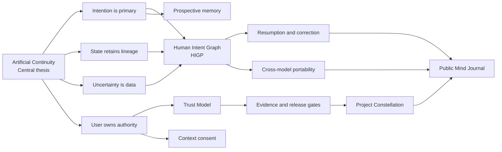
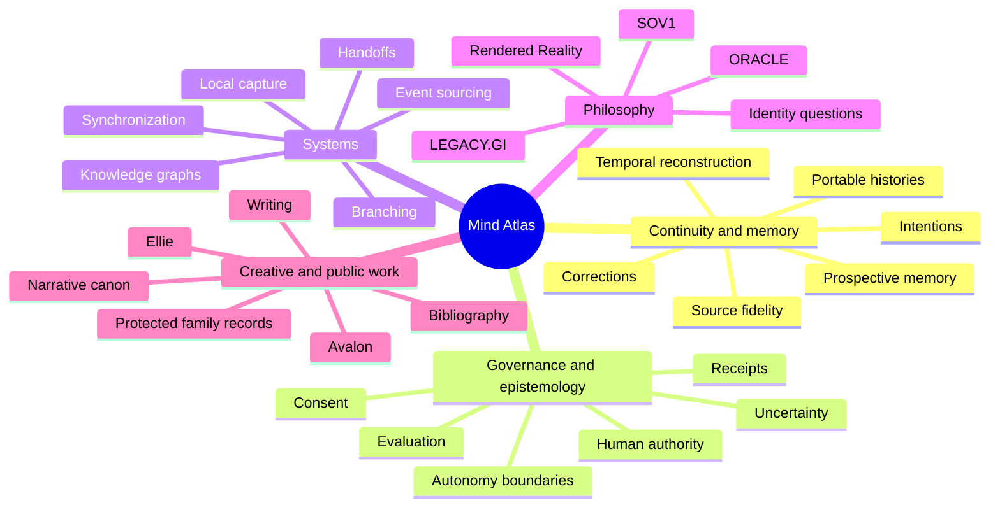

# Mind Map: Ideas, Documents, and Evidence
**Public candidate edition | 16 November 2026**

This map represents **research relationships**, not an empirical reconstruction of a brain or proof of identity. Nodes group related questions and inspected documents. Solid edges below represent a documented conceptual relationship in the current analysis, not proof that one idea historically caused another.

## Research constellation

## A fifty-theme navigational taxonomy

## Traceable path examples

| Concept | Evidence-bearing documents | Next empirical question |
|---|---|---|
| Intentions beyond chat | [Manifesto](BIBLIOGRAPHY.md#b01-artificial-continuity-working-manifesto), [HIGP](BIBLIOGRAPHY.md#b02-human-intent-graph-protocol-draft-01) | Does a typed intention graph improve delayed task resumption over strong retrieval? |
| Conditional reminders | [Prospective Memory](BIBLIOGRAPHY.md#b03-prospective-memory) | What are false-positive and false-negative trigger rates? |
| Governed action | [Trust Model](BIBLIOGRAPHY.md#b04-continuity-trust-model-v07), [Intention Bridge](BIBLIOGRAPHY.md#b07-intention-semantics-and-the-chatgpt-exchange) | How many unauthorized state changes are blocked without harming useful work? |
| Evidence thresholds | [Project Constellation](BIBLIOGRAPHY.md#b06-project-constellation) | Are release receipts independently reproducible? |
| Personal archive fidelity | [Living Archive](BIBLIOGRAPHY.md#b10-living-archive-private-messenger-evidence) | Do migration and retrieval preserve every original-source association? |
| Bounded remote context | [Context Consent](BIBLIOGRAPHY.md#b08-context-consent-receipts) | Can all outbound requests be accounted for and redaction reviewed? |

## Graph schema for future interactive visualization

Every public node should have: `id`, `label`, `kind`, `status`, `source_refs`, `first_seen` (if verified), `last_reviewed`, `author_attribution`, `privacy`, `confidence`, and `notes`.

Every edge should have: `from`, `to`, `relation`, `source_refs`, `evidence_status`, and `reviewed_at`. Recommended relationships: `SUPPORTS`, `CONTRADICTS`, `DEPENDS_ON`, `SUPERSEDES`, `DERIVED_FROM`, `ILLUSTRATES`, and `CITES`.

An unlabeled thematic resemblance is not an independently evidenced causal connection. An unresolved edge should remain explicitly **candidate**.

## Reading routes

**Research program:** [B01](BIBLIOGRAPHY.md#b01-artificial-continuity-working-manifesto) → [B02](BIBLIOGRAPHY.md#b02-human-intent-graph-protocol-draft-01) → [B06](BIBLIOGRAPHY.md#b06-project-constellation) → [methodology](METHOD.md).

**Practical assistant:** [B07](BIBLIOGRAPHY.md#b07-intention-semantics-and-the-chatgpt-exchange) → [B03](BIBLIOGRAPHY.md#b03-prospective-memory) → [B08](BIBLIOGRAPHY.md#b08-context-consent-receipts).

**Personal intellectual history:** [Mind Journal 50](MIND_JOURNAL_50.md) → [bibliography](BIBLIOGRAPHY.md) → [publication boundaries](METHOD.md).

The present Mermaid map is readable directly on GitHub. A separate filterable web graph remains a planned extension, not a completed feature.