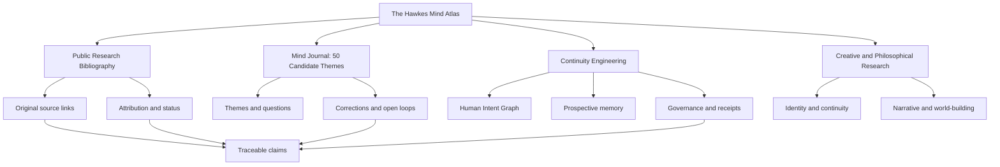

# The Hawkes Mind Atlas
### A public bibliography, mind journal, and navigable map of ideas
**Candidate public edition | 16 November 2026 | Editorial status: in progress**

> This is a research edition, not a definitive reconstruction of a person's mind. Its purpose is to connect public writing, technical artifacts, ideas, questions, revisions, and evidence without turning inference into biography or publication into proof.

## Begin here

- [The annotated bibliography](BIBLIOGRAPHY.md) lists source documents checked against actual GitHub paths.
- [The fifty-theme Mind Journal](MIND_JOURNAL_50.md) is an expansive *candidate thematic index*: connections are provisional unless their source links establish them.
- [The concept map](MIND_MAP.md) includes a browsable Mermaid diagram, a typed relationship map, and reading routes.
- [The evidence and editorial policy](METHOD.md) explains attribution, certainty, privacy, citation, correction, and publication boundaries.
- [The project roadmap](ROADMAP.md) distinguishes work completed in this edition from later article-census and cross-reference work.

## Why this atlas exists

Many records of a person's work preserve artifacts but lose the reasons those artifacts exist. A transcript preserves what was said, but not necessarily which remarks became commitments. A repository preserves code and documents, but can blur proposal, implementation, and demonstration. A bibliography organizes publications, but rarely captures the branching paths between an early question, a revised hypothesis, an adopted principle, an experiment, and a later correction.

The Hawkes Mind Atlas asks whether these can be represented as one inspectable, versioned research record. It collects **ideas**, **writings**, **technical proposals**, **tests**, **counterarguments**, and **unresolved questions**. The project is organized around a practical commitment: readers should be able to follow a claim back to what actually supports it.

This public edition is designed to remain useful even without private conversation archives. It does not publish raw chats, family histories, private correspondence, medical details, financial information, or unapproved memory assertions. Public references may point to previously published research, but they do not grant permission to expose the underlying private corpus.

## The central hypothesis

A capable assistant that answers individual prompts is not necessarily a good long-term collaborator. Useful continuity may require an explicit layer for:

1. **Human intention:** goals that persist when a chat ends.
2. **State and history:** the current situation and the events that made it so.
3. **Provenance:** which source supports which interpretation.
4. **Uncertainty:** distinctions among observed, inferred, disputed, proposed, and unknown.
5. **Authority:** who is allowed to classify, change, publish, or act.
6. **Resumption:** how interrupted work restarts without fabricated progress.
7. **Prospective relevance:** when deferred work becomes worth raising again.
8. **Verification:** receipts tied to exact revisions, environments, and claims.
9. **Portability:** an evidence record that survives changes of model and application.
10. **Correction:** a structure that retains superseded claims without silently rewriting the past.

These are research propositions, not conclusions about AI consciousness, personhood, or demonstrated identity transfer.

## Three distinct missions

**Remembering** is the preservation of authentic sources and relevant observations.

**Reconstructing** is the effort to recover a coherent state, reasoning trajectory, and documented decision history from those sources.

**Investigating continuation** asks whether future systems can sustain useful personal and project continuity across interruptions, model changes, and different computational substrates. It does not establish that a digital successor is biologically or personally identical to a human.

The missions are related but must not be collapsed into one claimed accomplishment.

## A visual overview

## What the current edition can and cannot claim

The bibliography contains an initial set of **directly inspected GitHub files** from the public repository `Noahhawkes/artificial-continuity`. Their paths and content were retrieved through the connected GitHub integration during the 16 November 2026 working session.

This is **not** yet a complete count of articles across all owned or accessible repositories. A repository can include third-party projects, licenses, code, references, documentation, duplicated sources, drafts, and original papers. Repository ownership alone does not settle individual-document authorship. The owner has stated that the articles they publish on their account are their writings; this statement is recorded as the author's assertion and is not silently contradicted or treated as independently verified for every file.

The fifty themes are a **candidate editorial taxonomy**, not a statistically validated ranking based on the full corpus. Source counts, thematic frequencies, and article-impact comparisons require a separate auditable census.

## Editorial independence of the evidence

A successful test in a README is a **reported test result**, not an independently rerun result. A source's assertion of novelty is not proof of novelty. A compelling research statement is not the same as a reproducible engineering demonstration. A first-person passage written by an assistant is not automatically the human author's literal words.

Corrections are additive. If a newer source supersedes an older statement, both states should remain traceable with dates and evidence.

## Publication principle

**The witness must not become the author.** Research tools can organize, compare, synthesize, and propose interpretation. The living human retains final correction and publication authority. Public presentation must never make private information public by implication.

## Suggested routes

- **For AI researchers:** [Manifesto](BIBLIOGRAPHY.md#b01-artificial-continuity-working-manifesto) → [HIGP](BIBLIOGRAPHY.md#b02-human-intent-graph-protocol-draft-01) → [Trust Model](BIBLIOGRAPHY.md#b04-continuity-trust-model-v07) → [Prospective Memory](BIBLIOGRAPHY.md#b03-prospective-memory).
- **For engineers:** [Architecture](BIBLIOGRAPHY.md#b05-continuity-architecture) → [Project Constellation](BIBLIOGRAPHY.md#b06-project-constellation) → [Intention semantics](BIBLIOGRAPHY.md#b07-intention-semantics-and-chatgpt-exchange).
- **For readers interested in ideas:** [Fifty-theme journal](MIND_JOURNAL_50.md) → [Mind map](MIND_MAP.md) → [Evidence method](METHOD.md).

---

*Public edition prepared from a limited inspected source set. Expansion requires further source review, attribution checks, duplicate resolution, and the author's approval of any sensitive personal content.*